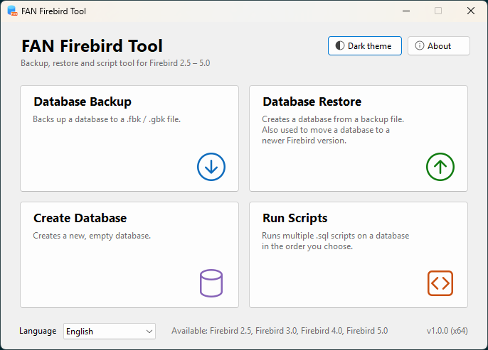
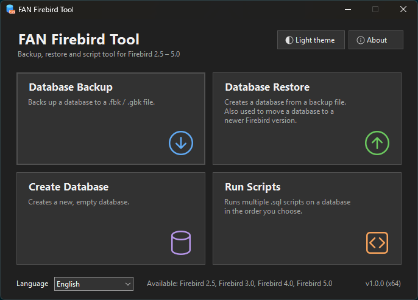
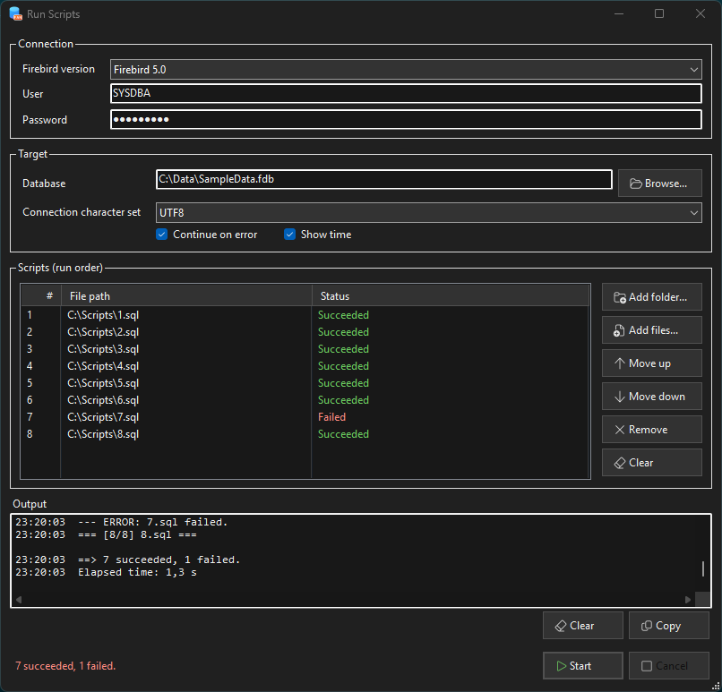

# FAN Firebird Tool

[English](README.md) | **Türkçe**

**Firebird 2.5 – 5.0 veritabanlarını yedeklemek, geri yüklemek ve oluşturmak**, ayrıca **birden fazla SQL script'ini seçilen sırayla çalıştırmak** için taşınabilir bir Windows aracı.
Kurulum ve Firebird sunucusu gerekmez: resmi Firebird komut satırı araçları pakete dahildir ve embedded modda çalışır.

[](LICENSE)


| Açık tema | Koyu tema |
|---|---|
|  |  |



## Özellikler

- **Tek araçta dört Firebird sürümü:** 2.5, 3.0, 4.0 ve 5.0; her işlemde seçilebilir.
- `gbak` ile **yedekleme ve geri yükleme**: canlı ayrıntılı çıktı ve iptal düğmesi. Sonuç önce geçici bir dosyaya yazılır, işlem başarılı olunca yerine taşınır. Böylece iptal edilen ya da hata veren bir işlem yarım yazılmış dosya bırakmaz.
- **Sürümler arası taşıma:** eski sürümle yedek alıp yeni sürümle geri yükleyin (ör. 2.5 → 5.0).
- **Boş veritabanı oluşturma:** sayfa boyutu (sadece seçili sürümün desteklediği değerler) ve varsayılan karakter seti seçilebilir.
- **SQL script'lerini sırayla çalıştırma:** klasör ya da tek tek dosya ekleme (Gezgin'deki gibi doğal sıralama, `2_x.sql` `10_x.sql`'den önce gelir), sürükle-bırak, sıralama, çıkarma. Her script'in kendi durumu görünür (bekliyor, çalışıyor, başarılı, hatalı, çalıştırılmadı), sonunda bir özet gösterilir. İsteğe bağlı *hatada devam et*.
- **Taşınabilir:** her şey kendi klasöründedir; ayarlar exe'nin yanındaki `settings.ini` dosyasına kaydedilir.
- **Türkçe ve İngilizce arayüz**, Windows diline göre otomatik seçilir. Yeni bir dil tek bir metin dosyasıyla eklenir (aşağıya bakın).
- **Açık ve koyu tema**, varsayılan olarak Windows ayarını izler.
- Uzun işlemlerde zamanın nerede geçtiğini görmek için logda isteğe bağlı saat bilgisi.

## İndirme ve çalıştırma

1. [Son sürümü](https://github.com/BarisKaratas1983/FANFirebirdTool/releases/latest) açın.
2. `FANFirebirdTool-<sürüm>-x64.zip` (64 bit Windows, önerilen) ya da `-x86.zip` (32 bit Windows) dosyasını indirin.
3. Yazma izniniz olan herhangi bir klasöre çıkarın (*Program Files* değil) ve `FANFirebirdTool.exe` dosyasını çalıştırın.

**Gereksinimler:** Windows 10 veya 11. .NET Framework 4.8 bu Windows sürümlerinde zaten bulunur. Başka hiçbir şey kurmanız gerekmez; paketler internet bağlantısı olmayan temiz bir Windows Sandbox'ta test edilmiştir.

Her sürümdeki `SHA256SUMS.txt` dosyası zip dosyalarının sağlama değerlerini içerir.

## Bilmekte fayda var

- Embedded modda kullanıcı adı ve parola denetlenmez; varsayılan `SYSDBA` / `masterkey` yeterlidir.
- Bir yedek aynı ya da **daha yeni** bir Firebird sürümüyle geri yüklenebilir, eski bir sürümle yüklenemez (ör. Firebird 5.0 yedeği 2.5 ile geri yüklenemez).
- Script'ler `isql` ile çalışır. `isql`'in hemen commit ettiği komutlar (ör. DDL) çalışma iptal edilse bile veritabanında kalır. Bu yüzden script çalıştırmadan önce yedek almanız önerilir.
- Firebird 2.5'in `gbak` aracı aynı veritabanında yeni sürümlere göre belirgin şekilde yavaştır. Bu, motorun kendi davranışıdır.

## Nasıl çalışır?

Her Firebird sürümü exe'nin yanında kendi klasöründedir:

```
FANFirebirdTool.exe
engines\
  fb25\  fb30\  fb40\  fb50\    gbak.exe, isql.exe ve embedded motor kütüphaneleri
licenses\
```

İşlemler, seçili sürümün `gbak.exe` ya da `isql.exe` aracını ayrı bir süreç olarak başlatır ve çıktısını canlı olarak loga aktarır. Araçlar ayrı süreçlerde çalıştığı için her motor kendi kütüphanelerini kullanır; sürümler ne birbiriyle ne de bilgisayarda kurulu bir Firebird sunucusuyla çakışır.

Kod katmanlara ayrılmıştır:

| Klasör | Görevi |
|---|---|
| `Core` | Süreç çalıştırıcı, dil desteği, ayarlar, tema, sonuç tipi |
| `Engines` | Firebird sürüm tanımları (klasörler, sayfa boyutları, karakter setleri) |
| `Operations` | Yedekleme, geri yükleme, oluşturma ve script çalıştırıcı; arayüz kodu içermez |
| `Controls` | Tekrar kullanılan arayüz parçaları ve yardımcılar |
| `Forms` | Pencereler (tüm arayüz kodla kurulmuştur, designer dosyası yoktur) |

## Kaynak koddan derleme

**Gereksinimler:** *.NET masaüstü geliştirme* iş yükü kurulu Visual Studio 2022 veya 2026.

1. Depoyu klonlayın.
2. Motor klasörlerini hazırlayın. Firebird dosyaları depoda tutulmaz; resmi [Firebird zip paketlerinden](https://firebirdsql.org/en/server-packages/) alın (2.5.9, 3.0, 4.0 ve 5.0 sürümleri; 64 bit ve 32 bit):

   ```
   engines\x64\fb25  fb30  fb40  fb50
   engines\x86\fb25  fb30  fb40  fb50
   ```

   - **3.0, 4.0, 5.0:** zip paketini klasöre çıkarın.
   - **2.5:** tam zip paketinin `bin` klasöründen `gbak.exe`, `isql.exe` ve diğer araçları, *embed* zip paketinin içeriğini alın; ardından araçların embedded modda çalışması için `fbembed.dll` dosyasını `fbclient.dll` adıyla kopyalayın.

3. `FANFirebirdTool.slnx` dosyasını açın, **x64** ya da **x86** seçip derleyin. Seçili platformun motorları exe'nin yanına otomatik kopyalanır.
4. Yayın zip'lerini oluşturmak için `build.cmd` dosyasını çalıştırın. Paketler `dist` klasörüne yazılır.

## Yeni dil ekleme

1. `FANFirebirdTool/Languages/en.txt` dosyasını iki harfli dil koduyla adlandırılmış yeni bir dosyaya kopyalayın, ör. `de.txt`.
2. Değerleri (`=` işaretinden sonraki metinleri) çevirin ve `language.name` satırını ayarlayın (ör. `language.name=Deutsch`).
3. Dosyayı projeye *Embedded Resource* olarak ekleyip derleyin.

Dil, dil listesinde otomatik olarak görünür. Eksik anahtarlar için İngilizce metin kullanılır.

## Bilinen sınırlamalar

- Ölçeği %100'ün üzerinde olan ekranlarda pencereyi Windows büyüttüğü için yazılar hafif bulanık görünebilir.
- Mesaj kutuları ve dosya diyalogları Windows tarafından çizilir ve açık temada kalır.

## İsim hakkında

*FAN*, **FreeAndNil** kelimesinin kısaltmasıdır: hem bilinen Delphi rutinine bir selam, hem de geliştiricinin takma adı.

## Lisans

FAN Firebird Tool [MIT Lisansı](LICENSE) ile dağıtılır.

Yayın paketleri, InterBase Public License ve Initial Developer's Public License ile dağıtılan resmi Firebird araçlarını ve [Fluent UI System Icons](https://github.com/microsoft/fluentui-system-icons) (MIT) simgelerini içerir. Ayrıntılar için [licenses/THIRD-PARTY-NOTICES.txt](licenses/THIRD-PARTY-NOTICES.txt) dosyasına bakın.

## Geliştirici

**Barış Karataş**
[GitHub](https://github.com/BarisKaratas1983) · [LinkedIn](https://www.linkedin.com/in/baris-karatas) · [baris.karatas@yahoo.com](mailto:baris.karatas@yahoo.com)
